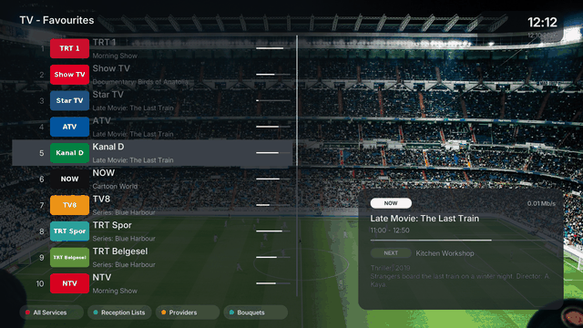

# TiviATV FHD

TiviMate düzeninde, 1920×1080 openATV / enigma2 skini.
Yuvarlak köşeler, gradientler, ilerleme çubukları ve seçim vurgusu — hepsi
enigma2'nin kendi çizim motoruyla, **tek bir PNG kullanılmadan**.



## Gereksinim

openATV **7.3+**. `cornerRadius`, gradient ve `itemCornerRadiusSelected`
enigma2 motoruna 7.3 ile girdi; 7.2 ve altındaki dallarda bu tanımlar yok,
köşeler kare çıkar.

## Kurulum

Klasörü olduğu gibi kutuya kopyala:

```
/usr/share/enigma2/TiviAtv-FHD/
```

Skinin iki küçük converter'ı var, enigma2'nin converter dizinine gider:

```
TiviAtv-FHD/converter/*.py  →  /usr/lib/enigma2/python/Components/Converter/
```

| Dosya | Ne yapar |
|---|---|
| `TiviAtvSignal.py` | InfoBar / kanal listesindeki sinyal (SNR/AGC) ya da IPTV akış hızı |
| `TiviAtvText.py` | Çözünürlük / codec / şifre rozetlerini boşken gizler (IPTV'de şifre rozeti hep boş hap olarak çiziliyordu) |

Kopyalanmazsa skin yine açılır, yalnız o alanlar boş kalır.

Sonra: **Menü → Ayarlar → Sistem → Kullanıcı arayüzü → Skin seçimi**

TiviMate görünümü için kanal listesini iki satırlı moda al —
**Menü → Ayarlar → Kanal seçimi**:

- "İki satırlı servis listesi" = **Evet**
- "Sayfa başına öğe" = **10**

> Kanal listesi satır yüksekliği skinden gelmez. enigma2 bunu
> `liste yüksekliği ÷ sayfa başına öğe` olarak hesaplar
> (`ServiceList.setItemsPerPage`), yani `serviceItemHeight` bu hesabın altında
> kalır. Satırlar sık ya da seyrek görünüyorsa o ayarı değiştir.

## Ekranlar

InfoBar, kanal listesi, menü, ayarlar ve ses bir Octagon SX88V2 4K üzerinde,
openATV 8.0'da çekildi; program rehberi, kanal menüsü ve klavye PC emülatöründen
(örnek kanal listesi ve EPG ile, bkz. [Emülatörde test](#emülatörde-test)).

### InfoBar

Saydam alt bant, kanal logosu, çift satır program bilgisi. Sağ üstte uydu
kanalında SNR/AGC yüzdeleri, IPTV'de akış hızı — ikisi de aynı alanı paylaşır,
hangi kaynak aktifse o görünür.


### Kanal listesi

İki satırlı servis listesi, picon, ilerleme çubuğu; sağda canlı önizleme ve
şimdi/sonraki kartı.


### Program rehberi

Zaman çizelgesi: şu an yayında olan programlar koyu mavi, seçili blok vurgu
renginde, kırmızı "şimdi" çizgisi. Renkler ve font motorun EPG listesine skin
attribute'larıyla verilir (önceden motorun varsayılan yeşil/sarı bloklarıydı).


Çoklu EPG: Şimdi / Sonraki / Daha sonra sekmeleri ve seçili programın kartı.


### Kanal menüsü

Kanal listesinde MENU: sağdan açılan çekmece.


### Sanal klavye

Alttan açılan sayfa; tuşlar PNG değil, motorun çizdiği kutular ve ikon fontu.


### Menü

Tam boy sol panel, 14 satır kapasite.


### Ayarlar


### Ses


## Tanımlı ekranlar

`InfoBar` · `SecondInfoBar` · `ChannelSelection` · `SimpleChannelSelection` ·
`ChannelSelectionRadio` · `EPGSelection` · `GraphicalEPG` · `GraphicalEPGPIG` ·
`EPGSelectionMulti` · `GraphMultiEPG` · `GraphMultiEPGList` · `EventView` ·
`Menu` · `Setup` · `MessageBox` · `ChoiceBox` · `Volume` ·
`Mute` · `NumberZap` · `AudioSelection` · `SkinSelection` · `PluginBrowser` ·
`PackageAction` · `ChannelContextMenu` · `InputBox` · `PinInput` · `PinInputPopup` ·
`VirtualKeyBoard` · `Console` · `TextBox` · `Information` · `TimerEditList` ·
`MoviePlayer` · `SimpleSummary`

Ayrıca enigma2'nin standart renk adları (`window-bg`, `window-fg`, `key_red`,
`grey` …) skin paletine eşlendi. Bunlar tanımsızken, skinde karşılığı olmayan
her ekran — üçüncü taraf eklentiler dahil — `parseColor` hatasına düşüp
okunaksız kalıyordu.

> EPG ekranlarının adı openATV 8 ile değişti: `GraphMultiEPG` yerine
> `GraphicalEPG` / `GraphicalEPGPIG` / `EPGSelectionMulti` aranıyor. Eski adlar
> 7.3–7.5 dalları için duruyor.

Burada tanımlı olmayan ekranlar openATV'nin kendi `skin_default.xml`'inden gelir,
yani hiçbir ekran boş kalmaz.

> `MessageBox` için `icon` widget'ı zorunlu: openATV'nin `skin.py`'si
> (`MANDATORY_WIDGETS`) eksik widget'lı ekranı reddedip varsayılan pencereyi
> açıyor. Yeni ekran eklerken bu listeye bak.

### PNG'siz motor kontrolleri

openATV 2026-09 itibarıyla bazı kontrolleri PNG yerine kendisi çizebiliyor;
skin bunları `<parameters>` bloğundan açar:

| Parametre / attribute | Etkisi |
|---|---|
| `EPGNativeControls` | Grafik EPG'deki "şimdi" çizgisi ve zaman çizgileri, çoklu EPG sekmeleri renkli etiket olur |
| `VirtualKeyboardNative` | Sanal klavye tuşları yuvarlak köşeli kutu + `enigma2icons` glifi |
| `ChoiceListNative` | ChoiceBox / kanal menüsü satırlarındaki numara ve madde ikonları |
| `iconFont` / `iconGlyphs` | MessageBox ve oynatıcı durum ikonları font glifinden |

Daha eski imajlar bu parametreleri yok sayar: tuşlar ve ikonlar
`skin_default` grafikleriyle çizilir, zaman çizgileri için iki tanım
`objectTypes` ile seçilir (Label ise renkli çizgi, Pixmap ise eski PNG).

## Özelleştirme

### Renkler

Tek yerden değişir — `TiviAtv-FHD/skin.xml` başındaki `<colors>` bloğu.

> **Alfa terstir.** Format `#AARRGGBB` ama `AA` = *şeffaflık*:
> `00` tamamen opak, `FF` tamamen görünmez. CSS'ten alışkın olanın en sık
> düştüğü tuzak.

Gradient, `<colors>` bloğunda **tanımlanamaz** — `parseColor` orada yalnız
`#aarrggbb` kabul eder, virgüllü değer sessizce beyaza düşer. Gradient doğrudan
elemanın attribute'una yazılır; `backgroundColor` / `foregroundColor` değerinde
virgül görürse `parseGradient`'e gider:

```xml
<eLabel backgroundColor="#001c1c24,#00141419,vertical" />
```

Sözdizimi: `başlangıç[,orta],bitiş,vertical|horizontal[,alphaBlend]`

### Yuvarlak köşeler

```xml
cornerRadius="24"                   <!-- dört köşe -->
cornerRadius="3;left"               <!-- sadece sol -->
cornerRadius="30;topLeft,topRight"  <!-- seçili köşeler -->
```

Geçerli köşe adları: `topLeft` `topRight` `top` `bottomLeft` `bottomRight`
`bottom` `left` `right`

### Font

Aktif yazı tipi `skin.xml`'de değil, ayrı bir `fonts.xml` dosyasında durur;
`skin.xml` onu `<include filename="fonts.xml" />` ile yükler. Skinde geçen font
adları (`TM` / `TMM` / `TMB` / `TMX`) hiç değişmez, sadece hangi `.ttf`
dosyasına baktıkları değişir.

Kutu üstünden değiştirmek için `plugin/TiviAtvFont` klasörünü

```
/usr/lib/enigma2/python/Plugins/Extensions/TiviAtvFont/
```

altına kopyala. **Menü → Kurulum → Kullanım & Kullanıcı Arayüzü → TiviATV Yazı
Tipi** altında, skin klasöründeki ve `/usr/share/fonts` altındaki yazı tipleri
listelenir; seçilen aile `fonts.xml`'e yazılır ve arayüz yeniden başlatılır.
Aynı ailenin birden çok ağırlığı varsa (örneğin Barlow'un dördü) dört slot
otomatik eşleşir, tek ağırlıklı bir font seçilirse dördü de ona bakar.

Seçim listesi enigma2'nin `ChoiceBox` ekranıdır — görünümü bu skinin
`<screen name="ChoiceBox">` tanımından gelir, eklentinin içinde gömülü skin
yoktur. `fonts.xml` elle de düzenlenebilir.

## Araçlar

Depo kökünden çalıştırılır, hiçbirinde sabit yol yok.

| Betik | Ne yapar |
|---|---|
| `tools/lint_skin.py` | Skini openATV'nin **gerçek** attribute listesine karşı denetler — `skin.py` ve `ServiceList.py`'yi upstream'den indirip parse eder. Tanımsız renk/font, ekran dışına taşan eleman, bilinmeyen attribute yakalar. |
| `tools/render_preview.py` | `preview.html`'i üretir — ekranları skin.xml'in gerçek koordinat, renk ve yarıçaplarından tarayıcıda çizer. |
| `tools/make_thumb.py` | Skin seçicideki `prev.png`'yi üretir. |
| `tools/make_designer_copy.py` | OpenSkin Designer uyumlu kopya üretir (aşağıya bak). |
| `tools/emulator/` | PC emülatöründe skin testi: örnek kanal/EPG, test yayını, tüm ekranların görüntüsü (aşağıya bak). |

Gereksinim: Python 3.9+ ve `Pillow` (yalnız `make_thumb.py` için).

```bash
pip install pillow
```

## Emülatörde test

Kutuya gitmeden, PC'de derlenmiş OpenATV enigma2 (SDL2) üzerinde denenir.
Emülatörün kendisi FY Sinema deposundaki `tools/e2pc/kur.sh` ile kurulur
(`e2-arkaplan`, `e2-tus`, `e2-ekran` oradan gelir); bu klasör üstüne skin
testine özel parçaları ekler:

| Dosya | Ne yapar |
|---|---|
| `TiviAtvTest/` | Yalnız emülatöre kurulan eklenti: `/tmp/e2py.cmd`'deki Python kodunu enigma2'nin içinde çalıştırır, açılışta örnek EPG'yi yükler. Kutuya **kurulmaz**. |
| `e2-py` | Bu eklentiye kod gönderir: `e2-py 'session.open(...)'` |
| `demo_kanallar.py` | 16 kanallık örnek liste (4 Türksat 42E + 12 IPTV), EPG, picon ve test yayını üretir (enigma2 kapalıyken) |
| `e2-yayin` | IPTV kanallarının çaldığı test yayını (`127.0.0.1:8099`, ffmpeg) |
| `ekranlar.py` | Ekranları menüde gezinmeden tek tek açıp görüntüsünü alır |

```bash
ln -sfn $PWD/TiviAtv-FHD /usr/share/enigma2/TiviAtv-FHD
ln -sf  $PWD/TiviAtv-FHD/converter/*.py /usr/lib/enigma2/python/Components/Converter/
ln -sfn $PWD/tools/emulator/TiviAtvTest /usr/lib/enigma2/python/Plugins/Extensions/TiviAtvTest
python3 tools/emulator/demo_kanallar.py && tools/emulator/e2-yayin && e2-arkaplan
python3 tools/emulator/ekranlar.py                 # hepsi  -> .cache/ekranlar/
python3 tools/emulator/ekranlar.py /tmp/ss menu epgselection
```

## OpenSkin Designer notları

[OpenSkin Designer](https://github.com/iMaxxx/OpenSkin-Designer) 2014'ten ve
skini olduğu gibi açamaz. `tools/make_designer_copy.py` uyumlu bir kopya üretir:

| Sorun | Neden | Kopyada |
|---|---|---|
| `<alias>` | `cDataBase.initFonts` `<fonts>` altındaki **her** çocuk düğümden `filename` okuyor, düğüm adı filtresi yok → `NullReferenceException` | kaldırılır |
| Blok içi XML yorumları | Yorum düğümünde hiç attribute yok, aynı çökme | kaldırılır |
| Gradient renk değerleri | `#a,#b,vertical` renk olarak ayrıştırılamaz | iki durağın ortalaması alınır |
| `<windowstyle>` içindeki `listbox`/`label`/`configList`/`scrolllabel` | Çalışan örnek skinlerde yok, `name` attribute'u yok | kaldırılır |

`cornerRadius` string'i programın binary'sinde hiç geçmiyor — skin tasarımcıda
**her zaman kare köşeli** görünür. Yuvarlaklık yalnız kutuda, enigma2 çizerken
ortaya çıkar.

```bash
python tools/make_designer_copy.py
```

## Lisans

Skin dosyaları MIT ile — bkz. [LICENSE](LICENSE).
Barlow fontu SIL Open Font License 1.1 altındadır, ayrıntılar `OFL-Barlow.txt`.
`Sony_Sketch_Bold_205.ttf` üçüncü taraf bir fonttur; dağıtım hakları skin
lisansının kapsamı dışındadır.
Kanal logoları (picon) skine dahil değildir; ayrı paket olarak
`/usr/share/enigma2/picon/` altına kurulur.

---

## In English

A TiviMate-style 1080p skin for openATV / enigma2. Rounded corners, gradients,
progress bars and selection highlights are drawn by the enigma2 engine itself —
**no PNG assets at all**.

Needs openATV **7.3+** — that is when `cornerRadius`, gradients and
`itemCornerRadiusSelected` landed in the engine.

Copy the folder to `/usr/share/enigma2/`, pick it under
**Menu → Setup → System → User interface → Skin**, and enable the two-line
service list for the TiviMate layout.

The `tools/` scripts regenerate the preview and the thumbnail from `skin.xml`.
